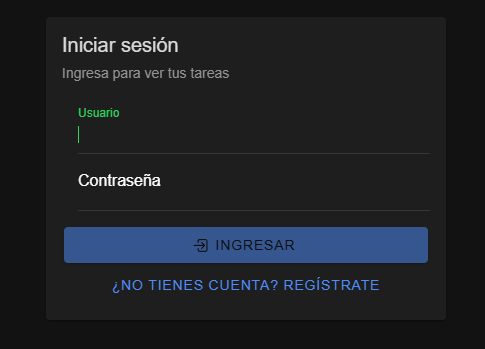
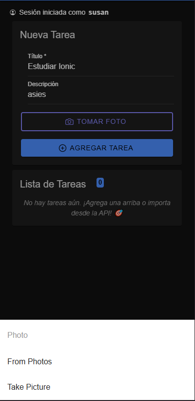
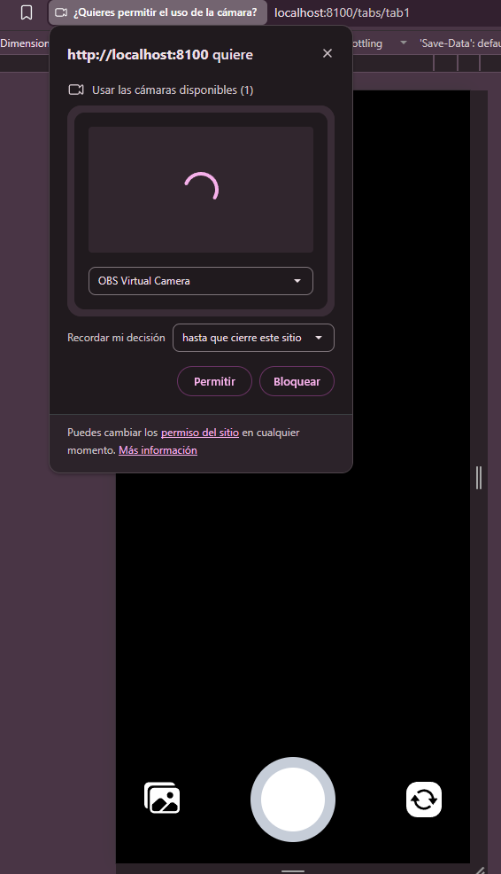
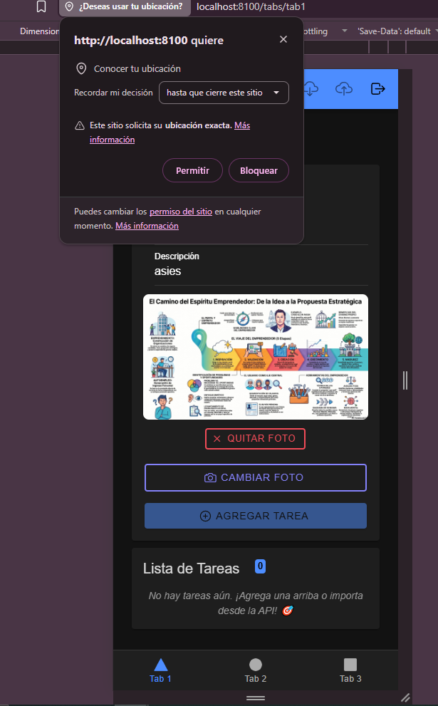
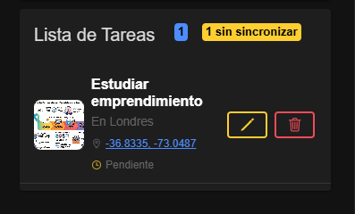
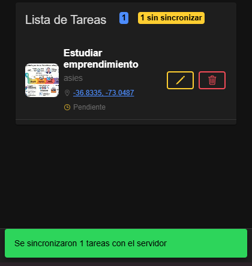
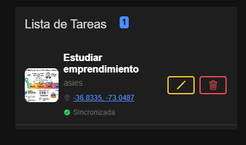
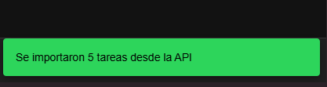
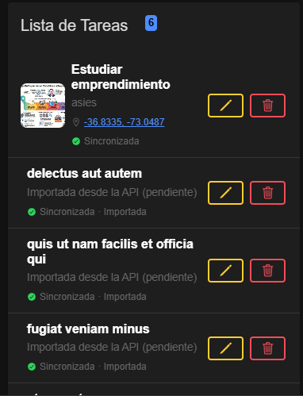
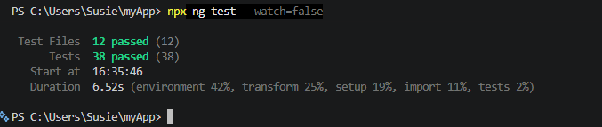

# Documentación del Proyecto — Parte 2: ToDo List Avanzada con Ionic y Capacitor

**Estudiante:** Susan Arteaga M  
**Fecha de entrega:** 15 de noviembre de 2026  
**Asignatura:** Desarrollo de aplicaciones móviles  
**Instructor:** Vicente Zapata

---

## 1. Descripción del Proyecto (Parte 2)

En esta segunda etapa se amplió la aplicación móvil **ToDo List** desarrollada con Ionic y Angular, incorporando los periféricos de cámara y GPS mediante plugins de capacitor, almacenamiento local avanzado, un sistema de autenticación multiusuario con protección de rutas, integración con una API REST externa para importar y sincronizar tareas remotamente, y una suite de  pruebas unitarias y de integración automatizadas con Vitest.

---

## 2. Requisitos del Sistema Ampliados

| Categoría | Requisito | Estado |
|---|---|---|
| **Periféricos** | Capturar imágenes desde la cámara o galería y adjuntarlas a cada tarea | ✅ Cumplido |
| **Periféricos** | Registrar automáticamente la ubicación GPS (latitud y longitud) al crear cada tarea | ✅ Cumplido |
| **Servicios Web y APIs** | Sincronizar las tareas locales pendientes con un servicio web externo (`POST`) | ✅ Cumplido |
| **Servicios Web y APIs** | Importar tareas desde una API externa (`GET`) e integrarlas a la lista local | ✅ Cumplido |
| **Pruebas Automatizadas** | Pruebas unitarias y de integración para cámara, geolocalización, API, almacenamiento y login | ✅ Cumplido (38 tests) |
| **Evolución: Almacenamiento** | Almacenamiento local persistente con Capacitor Preferences (funciona offline) | ✅ Cumplido |
| **Evolución: Autenticación** | Registro, inicio/cierre de sesión con hash SHA-256 y listas aisladas por usuario | ✅ Cumplido |

---

## 3. Tecnologías y Plugins Utilizados

| Tecnología / Plugin | Versión | Propósito en el proyecto |
|---|---|---|
| **Node.js** | v24.16.0 | Entorno de ejecución |
| **Ionic CLI** | 7.2.1 | Herramienta de línea de comandos para desarrollo y compilación |
| **Ionic Framework** | `@ionic/angular` 9.0.9 | Componentes de interfaz móvil (Standalone Components) |
| **Angular** | 22.2.3 | Framework frontend, inyección de dependencias, `HttpClient` y Router Guards |
| **Capacitor Core / CLI** | 8.5.3 | Puente nativo multiplataforma |
| **`@capacitor/camera`** | 8.2.6 | Captura de fotografías y selección desde galería en formato Base64 (`DataUrl`) |
| **`@capacitor/geolocation`** | 8.2.4 | Obtención de coordenadas GPS de alta precisión (`latitude`, `longitude`) |
| **`@capacitor/preferences`** | 8.0.1 | Almacenamiento clave-valor persistente en el dispositivo (usuarios, sesión y tareas) |
| **`@ionic/pwa-elements`** | 3.4.0 | Interfaz web para el modal de cámara cuando se ejecuta en navegador |
| **Vitest** | 5.0.5 | Ejecución de pruebas unitarias y de integración automatizadas |

---

## 4. Estructura de Archivos del Proyecto

```text
myApp/
├── src/
│   ├── main.ts                                  ← Bootstrap con provideHttpClient() y pwa-elements
│   ├── environments/
│   │   ├── environment.ts                       ← Configuración de URL de API (JSONPlaceholder)
│   │   └── environment.prod.ts                  ← Configuración de producción
│   └── app/
│       ├── app.routes.ts                        ← Definición de rutas protegidas con authGuard
│       ├── models/
│       │   └── tarea.model.ts                   ← Interfaces Tarea y Ubicacion
│       ├── login/
│       │   ├── login.page.ts                    ← Lógica de inicio de sesión y registro
│       │   ├── login.page.html                  ← Interfaz de usuario de autenticación
│       │   ├── login.page.scss                  ← Estilos de la vista de login
│       │   └── login.page.spec.ts               ← Pruebas automatizadas del componente Login
│       ├── services/
│       │   ├── preferences.token.ts             ← InjectionToken para Capacitor Preferences
│       │   ├── auth.service.ts                  ← Registro, login, sesión y hash SHA-256
│       │   ├── auth.service.spec.ts             ← Pruebas de autenticación (9 tests)
│       │   ├── auth.guard.ts                    ← Guardias de navegación (authGuard / invitadoGuard)
│       │   ├── camara.service.ts                ← Servicio de captura de imágenes con Camera
│       │   ├── camara.service.spec.ts           ← Pruebas del periférico cámara (5 tests)
│       │   ├── ubicacion.service.ts             ← Servicio de GPS y enlace a Google Maps
│       │   ├── ubicacion.service.spec.ts        ← Pruebas del periférico GPS (5 tests)
│       │   ├── almacenamiento.service.ts        ← Persistencia local separada por usuario
│       │   ├── almacenamiento.service.spec.ts   ← Pruebas de aislamiento por usuario (2 tests)
│       │   ├── api-tareas.service.ts            ← Sincronización (POST) e importación (GET)
│       │   └── api-tareas.service.spec.ts       ← Pruebas de integración con API (3 tests)
│       └── tab1/
│           ├── tab1.page.ts                     ← Lógica principal de gestión de tareas
│           ├── tab1.page.html                   ← Interfaz principal (formulario, cámara, lista)
│           ├── tab1.page.scss                   ← Estilos de miniaturas, metadatos y estados
│           └── tab1.page.spec.ts                ← Pruebas de integración de la página (5 tests)
├── capacitor.config.ts
├── angular.json
└── package.json
```

---

## 5. Arquitectura y Funcionalidades Implementadas

### 5.1 Modelo de Datos Ampliado (`tarea.model.ts`)
Cada tarea almacena ahora información multimedia, geográfica y de sincronización:
- `id`, `titulo`, `descripcion`: datos principales de la tarea.
- `foto?: string`: imagen en formato `data:image/jpeg;base64,...`.
- `ubicacion?: { latitud: number; longitud: number }`: coordenadas GPS donde se registró la tarea.
- `fechaCreacion: string`: marca temporal en formato ISO.
- `sincronizada: boolean`: indica si la tarea ya fue enviada al servidor remoto.
- `origen: 'local' | 'api'`: distingue tareas creadas en el dispositivo de las importadas.

### 5.2 Captura de Imágenes (`CamaraService`)
Utiliza el plugin `@capacitor/camera` con `Camera.getPhoto()` configurado con `CameraResultType.DataUrl`, `CameraSource.Prompt` (permite elegir entre tomar fotografía o abrir galería) y compresión (`quality: 50`, `width: 600`) para optimizar el almacenamiento local. Si el usuario cancela la captura, el servicio controla la excepción y devuelve `null` sin interrumpir la aplicación.

### 5.3 Geolocalización GPS (`UbicacionService`)
Utiliza `@capacitor/geolocation` mediante `Geolocation.getCurrentPosition({ enableHighAccuracy: true, timeout: 10000 })`. Al guardar una nueva tarea, se adjuntan automáticamente la latitud y longitud actuales y se genera un enlace directo a Google Maps. Si el permiso es denegado, la aplicación muestra un aviso informativo (`ion-toast`) y guarda la tarea sin coordenadas.

### 5.4 Integración con API Externa (`ApiTareasService`)
Conecta la aplicación con el servicio REST `https://jsonplaceholder.typicode.com`:
- **Importación (`GET /todos?_limit=5`):** descarga tareas externas, las transforma al modelo local y las almacena en el dispositivo.
- **Sincronización (`POST /todos`):** filtra las tareas con `sincronizada === false`, las envía mediante peticiones HTTP `POST` en paralelo (`forkJoin`) incluyendo sus coordenadas GPS y metadatos, y actualiza su estado a **Sincronizada**.
  *(Nota: JSONPlaceholder es una API pública de pruebas que simula la creación devolviendo HTTP 201).*

### 5.5 Almacenamiento Local y Autenticación Multiusuario (`AuthService` y `AlmacenamientoService`)
- Los usuarios se registran e inician sesión localmente. Las contraseñas se procesan con `crypto.subtle.digest('SHA-256', ...)` junto con el nombre de usuario como *salt*, evitando guardar contraseñas en texto plano.
- Las rutas principales están protegidas con `authGuard`.
- Cada usuario posee su propio espacio de almacenamiento en `Capacitor Preferences` bajo la clave `tareas_<usuario>`, garantizando privacidad entre múltiples cuentas y funcionamiento 100 % offline.

---

## 6. Pruebas Automatizadas de Periféricos y Servicios

Para probar los periféricos sin depender del hardware físico durante las pruebas automatizadas, se utilizaron `InjectionToken` (`CAMERA_PLUGIN`, `GEOLOCATION_PLUGIN`, `PREFERENCES_PLUGIN`) que permiten inyectar *mocks* con Vitest (`vi.fn()`).

Comando de ejecución:
```bash
npx ng test --watch=false
```

| Suite de Pruebas | N.º Tests | Casos Verificados |
|---|---|---|
| `camara.service.spec.ts` | 5 | Creación del servicio, retorno de DataUrl, parámetros de captura, cancelación del usuario y respuesta sin imagen |
| `ubicacion.service.spec.ts` | 5 | Creación del servicio, obtención de latitud/longitud, opción `enableHighAccuracy`, permiso denegado y generación de URL a Google Maps |
| `api-tareas.service.spec.ts` | 3 | Importación `GET` y mapeo de datos, sincronización `POST` solo de tareas pendientes, omisión cuando no hay pendientes |
| `auth.service.spec.ts` | 9 | Registro, hash SHA-256 de contraseña, bloqueo de duplicados, validaciones de longitud, login exitoso, credenciales inválidas, logout y restauración de sesión |
| `almacenamiento.service.spec.ts` | 2 | Persistencia de tareas y aislamiento de listas entre distintos usuarios |
| `login.page.spec.ts` | 4 | Creación de la vista, login y redirección, visualización de errores y validación de confirmación de contraseña |
| `tab1.page.spec.ts` | 5 | Integración completa: adjuntar foto, crear tarea con foto + GPS, crear tarea cuando falla el GPS y cierre de sesión |
| Otros componentes base | 5 | `AppComponent`, `TabsPage`, `Tab2Page`, `Tab3Page`, `ExploreContainerComponent` |
| **Total** | **38** | **12 archivos de prueba — 38 pruebas aprobadas (100 %)** |

---

## 7. Capturas de Pantalla

### 7.1 Pantalla de Registro e Inicio de Sesión (`/login`)
<p align="center"></p>


---

### 7.2 Cámara y Vista Previa
<p align="center"></p>

<p align="center"></p>


---

### 7.3 Tarea Registrada con Miniatura de Foto y Coordenadas GPS
<p align="center"></p>

<p align="center"></p>

---

### 7.4 Sincronización de Tareas con la API Remota
<p align="center"></p>

<p align="center"></p>
*Mensaje de confirmación tras presionar el botón de sincronización y cambio del estado de las tareas a "Sincronizada".*

---

### 7.5 Importación de Tareas desde la API Externa
<p align="center"></p>

<p align="center"></p>
*Tareas descargadas desde la API externa (JSONPlaceholder) integradas en la lista local con la etiqueta "Importada".*

---

### 7.6 Ejecución de Pruebas Automatizadas en Terminal
<p align="center"></p>

*Salida del comando `npx ng test --watch=false` mostrando los 12 archivos de prueba y las 38 pruebas automatizadas aprobadas.*

---

## 8. Instrucciones de Ejecución

1. Instalar dependencias:
   ```bash
   npm install
   ```
2. Ejecutar el servidor de desarrollo en el navegador:
   ```bash
   ionic serve
   ```
   Disponible en: <http://localhost:8100>
3. Ejecutar las pruebas automatizadas:
   ```bash
   npx ng test --watch=false
   ```

---


